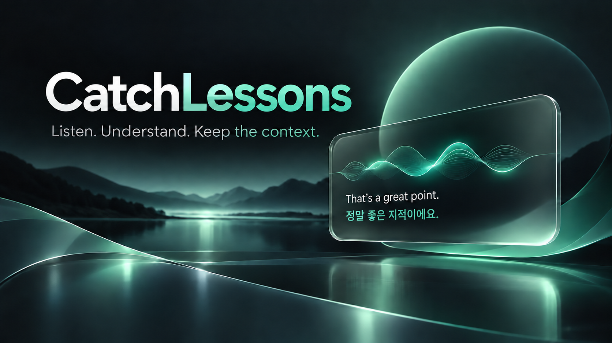
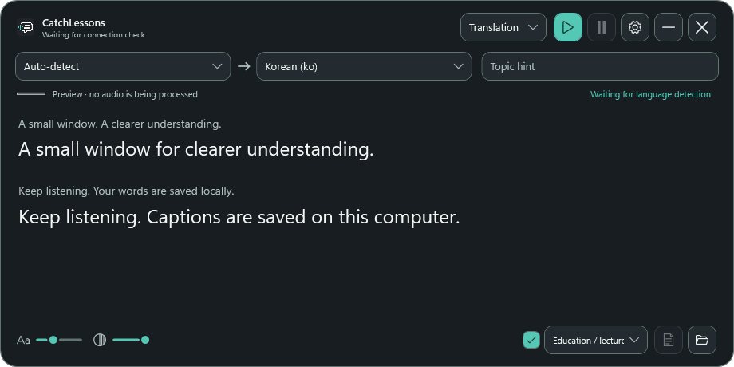

<p align="center"></p>

# CatchLessons

PC에서 재생되는 소리를 받아 원문과 선택적인 번역을 플로팅 화면에 보여주고, 자막과 요약을 로컬에 저장하는 개인용 데스크톱 앱입니다.

편하게 공부하기 위해 만든 앱이며, 전문 번역 앱은 아닙니다.

[English](README.md)

> **완전한 실시간 번역은 아닙니다.** 원문 미리보기는 확정 전 결과입니다. 확정 자막은 음성을 구간별로 인식한 뒤 Agent에 번역을 요청하므로 표시가 늦어지거나 앞서 보인 미리보기가 바뀔 수 있습니다. 네트워크, Agent 응답, 음성 분할과 PC 성능에 따라 지연이 달라지며 고정된 지연 시간은 보장하지 않습니다.

<p align="center"></p>

## ✨ 주요 기능

- **번역 또는 녹취:** 원문과 번역을 함께 보거나 원문만 기록합니다.
- **플로팅 자막:** 창을 이동·크기 조절할 수 있고 마우스를 벗어나면 조작부가 숨겨집니다. 글자 크기와 투명도를 조절합니다.
- **녹음 일시정지:** 새 오디오 입력을 멈춥니다. 이미 입력된 음성의 전사와 대기 중인 번역은 계속 진행하며, 재개 후 녹음 시간은 이어집니다.
- **요약:** 카테고리와 요약 언어를 고르고 프롬프트를 편집해 Markdown 또는 일반 텍스트로 저장합니다. 확정된 원문을 기준으로 수동 실행하거나 중지 시 자동 실행할 수 있습니다.
- **Agent:** 녹음마다 로그인된 Codex 또는 Claude CLI 대화 하나를 사용합니다. 모델·effort와 번역 지침을 선택할 수 있습니다. Codex Fast 모드는 선택 사항이며 사용량이 늘어날 수 있습니다.
- **로컬 또는 API 음성 인식:** 로컬 Whisper가 기본값입니다. OpenAI API 인식은 별도 API 키가 필요합니다.
- **백그라운드 실행:** 창을 닫으면 숨겨지고 트레이/메뉴 막대에서 복원하거나 종료합니다.

요약과 번역은 같은 녹음의 Agent 대화를 사용합니다. 수동 요약과 번역 요청은 순차 처리되므로 긴 요약이 이후 번역을 지연시킬 수 있습니다. 수동 요약은 확정 원문을 기준으로 하며, 아직 끝나지 않은 미리보기는 포함되지 않을 수 있습니다.

녹음을 중지해도 원문과 번역이 화면에 남아 다시 읽거나 요약할 수 있으며, 새 녹음을 시작할 때 초기화됩니다. Codex 녹음은 세션 ID 옆 아이콘으로 같은 로컬 대화를 Codex 앱에서 열 수 있습니다. 세션 ID는 복사할 수도 있습니다. Codex와 CatchLessons가 같은 로컬 Codex 기록을 사용해야 합니다. `codex exec`로 만든 세션은 Codex 사이드바에 자동으로 나타나지 않을 수 있습니다.

## 📦 다운로드 및 설치

| 플랫폼 | 설치 파일 | 상태 |
| --- | --- | --- |
| Windows x64 | [설치 파일 다운로드 (.exe)](https://github.com/dlcks7456/catch-lessons/releases/download/v1.0.2/CatchLessons-Windows-x64-1.0.2.exe) | 설치 마법사 제공, Windows 설정에서 제거 가능 |
| macOS 14+ · Apple Silicon | [설치 파일 다운로드 (.pkg)](https://github.com/dlcks7456/catch-lessons/releases/download/v1.0.2/CatchLessons-macOS-arm64-1.0.2.pkg) | 시험판, 실기기 설치 미검증 |
| macOS 14+ · Intel | [설치 파일 다운로드 (.pkg)](https://github.com/dlcks7456/catch-lessons/releases/download/v1.0.2/CatchLessons-macOS-x64-1.0.2.pkg) | 시험판, 실기기 설치 미검증 |

다운로드한 설치 파일을 실행하고 안내에 따라 설치하세요. Codex CLI 또는 Claude Code는 별도 설치 및 로그인이 필요합니다. Windows에서는 **설정 → 앱 → 설치된 앱 → CatchLessons → 제거**로 삭제할 수 있으며 녹음과 설정은 유지됩니다.

설치 시 **로컬 Whisper 설치가 기본 선택**입니다. 기존 로컬 모델이 없을 때 선택을 해제하면 OpenAI API 전용 설치가 되며 연결 설정에서 API 키를 입력해야 합니다. 재설치 시 유효한 Whisper 모델이 이미 있으면 선택을 해제해도 재사용하며, 저장된 음성 엔진 설정은 유지됩니다. 설치 파일에는 .NET 런타임과, 선택 시 사용할 기본 Whisper·VAD 모델이 포함됩니다. 설치 프로그램은 Agent 실행 파일을 확인하고 로그인 필요 여부를 안내하지만 Agent를 대신 설치하거나 로그인하지는 않습니다.

현재 Windows 설치 파일은 **서명되지 않아** Windows 평판 검사 경고가 나타날 수 있습니다. Mac 스크립트는 기본적으로 서명되지 않은 패키지/임시 서명 앱을 만듭니다. 공개 Mac 배포에는 Developer ID 서명과 공증이 필요합니다. Mac 설치·오디오 캡처·Keychain·단축키는 Mac에서 확인하지 않았습니다.

## 🚀 시작하기

1. 사용할 Agent를 설치하고 로그인합니다: [Codex CLI](https://developers.openai.com/codex/cli) 또는 [Claude Code](https://code.claude.com/docs/en/setup).
2. 설치 파일을 실행하고 로컬 Whisper 포함 여부를 고릅니다.
3. **설정 → 연결**에서 Agent와 음성 인식 엔진을 선택합니다. OpenAI API 인식을 사용하면 API 키를 입력합니다.
4. 원문 언어의 자동 감지 또는 고정 언어, 번역 언어, 선택적인 주제 힌트를 설정합니다. 번역 기본값은 한국어이고 앱 화면 기본값은 영어입니다. 화면 언어는 한국어로 바꿀 수 있습니다.
5. 녹음을 시작하고 필요할 때 일시정지·재개합니다. 중지하면 자막을 저장하고, 활성화한 경우 요약을 만듭니다.

Windows는 마이크가 아닌 시스템 출력 장치를 캡처합니다. macOS 캡처 경로는 준비됐지만 미검증입니다. Whisper를 로컬로 사용하더라도 번역과 요약에는 선택한 Agent의 인터넷 연결이 필요합니다. API 음성 인식은 오디오를 OpenAI로 보내며 API 비용이 발생할 수 있습니다. Codex/Claude 사용량은 해당 계정과 요금제에 따릅니다. 원음 WAV 저장은 선택 사항이며 기본적으로 꺼져 있습니다.

## ⌨️ 단축키

| 동작 | 기본값 |
| --- | --- |
| 시작 / 중지 | Windows `Ctrl + Alt + R`, Mac `⌘ + Option + R` |
| 일시정지 / 재개 | Windows `Ctrl + Alt + P`, Mac `⌘ + Option + P` |
| 설정 | Windows `Ctrl + Alt + S`, Mac `⌘ + Option + S` |

설정에서 단축키를 바꿀 수 있습니다. Windows에서는 등록 가능한 조합을 전역 단축키로 사용하며 충돌한 키는 설정에 표시하고 실행하지 않습니다. 현재 Mac 구현은 앱에 포커스가 있어야 하며 실제 Mac에서 확인하지 않았습니다.

## 🗂️ 저장 구조

기본적으로 `Documents/CatchLessons/` 아래에 녹음별 폴더가 만들어집니다.

```text
<시간>_<고유번호>/
├── srt/
│   ├── original.srt
│   └── translation.srt       # 번역 모드에서만 생성
├── txt/
│   ├── original.txt
│   └── translation.txt       # 번역 모드에서만 생성
├── <생성된 제목>.<언어>.md    # 요약 실행 시; .txt 선택 가능
└── audio.wav                 # 원음 저장 옵션을 켠 경우에만 생성
```

사용자가 설정한 후속 워크플로우는 의도적으로 다른 파일을 만들 수 있습니다. 기존 녹음은 이동하거나 삭제하지 않습니다. 기존 설정과 API 키를 유지하기 위해 내부 설정 저장 위치는 이전 CaptionGlass 이름을 사용합니다. 복구용 데이터베이스와 세션 메타데이터는 앱 데이터 폴더에 별도로 보관하며, 별도의 원문·지연 JSONL 로그는 더 이상 만들지 않습니다. 요약에는 YAML frontmatter와 문서 연결 링크를 넣지 않습니다.

## 🔄 업데이트

빌드에 `dlcks7456/catch-lessons` 저장소가 지정되어 있으며 **설정 → 일반**에서 GitHub Release 업데이트를 확인합니다. 자동 업데이트 기능이 포함된 빌드에서는 **업데이트**를 누르면 백그라운드에서 설치 파일의 무결성을 확인한 뒤 설치합니다. Windows에서는 설치 진행 상태가 표시되고 macOS에서는 관리자 인증이 필요합니다. 기존 릴리스에서 이 기능을 사용하려면 한 번은 수동으로 새 버전을 설치해야 합니다. 현재 확인 기능은 공개 GitHub Release만 지원합니다.

앱과 설치 파일의 버전은 `Directory.Build.props`에서 관리합니다. 추후 저장소에서 `.github/workflows/build-installers.yml`을 수동 실행해 빌드 산출물을 만들 수 있으며, 릴리스를 자동 게시하지 않습니다. 설치 프로그램 워크플로우는 GitHub Actions에서 실행했으며, Mac 패키지의 실기기 설치는 아직 검증하지 않았습니다.

<details>
<summary>개발자를 위한 빌드 안내</summary>

## 🛠️ 빌드

### Windows

.NET 10 SDK, Inno Setup 6, 모델 파일이 없을 경우 인터넷 연결이 필요합니다.

```powershell
./scripts/build.ps1
./scripts/build-windows-installer.ps1
```

설치 파일 빌더는 모델 SHA-256을 검증하고 `artifacts/installers/`에 독립 실행 파일을 만듭니다. `./scripts/verify-windows-installer.ps1`은 작업 폴더의 고유 경로에서 두 설치 선택지를 테스트하고 해당 테스트 설치를 제거합니다. 기존 CatchLessons 설치 등록이 있으면 실행하지 않습니다.

### macOS — 빌드 완료, 실기기 미검증

.NET 10 SDK와 Xcode Command Line Tools가 설치된 macOS 14 이상에서 실행합니다.

```bash
bash installer/macos/build-pkg.sh
```

앱과 CPU 아키텍처별 패키지를 만들고, 필요한 경우 모델을 내려받아 체크섬을 확인합니다. 로컬 모델 설치 여부를 선택할 수 있도록 준비했습니다. 이 스크립트는 GitHub의 macOS 빌드 환경에서 실행했으며 실기기 설치는 검증하지 않았습니다. 선택적인 `CAPTION_APP_SIGN_IDENTITY`와 `CAPTION_INSTALLER_SIGN_IDENTITY`로 로컬 서명을 지정할 수 있으며 공증은 별도 릴리스 단계입니다.

</details>

## 🔒 데이터와 제한

- 로컬 Whisper는 음성을 기기에서 처리합니다. 번역·요약·설정된 후속 작업에는 전사 텍스트가 선택한 Agent로 전달됩니다.
- 선택적인 WAV 녹음은 세션 폴더에 저장합니다. API 음성 인식은 음성을 OpenAI에 보냅니다.
- 중지 후 지침은 Agent의 기존 권한 정책에 따라 설정된 도구와 MCP를 사용할 수 있습니다. 비우면 실행하지 않습니다.
- 화자 구분과 화자별 음성 파일 분리는 구현하지 않았습니다.
- 사용자가 직접 만든 카테고리 이름과 지침은 사용자 데이터이므로 앱 화면 언어를 바꿔도 자동 번역하지 않습니다.

## 🧪 검증과 출처

현재 리뷰는 로컬 회귀 검사, 합성 일시정지·대기열 검사, 공개 음성 샘플과 격리된 Windows 설치 검사를 포함합니다. 정확한 결과와 미확인 항목은 [VERIFICATION.md](VERIFICATION.md)를 참고하세요. 이 검사만으로 모든 장치의 실제 캡처 품질을 보장하지는 않습니다.

CatchLessons는 Whisper.net, whisper.cpp, Silero VAD, NAudio, SQLite, Avalonia, Phosphor Icons와 LobeHub 브랜드 자산을 사용합니다. 고지는 [Assets/Licenses](Assets/Licenses)와 [Assets/Icons](Assets/Icons)에 있습니다. 히어로와 설치 일러스트는 이 프로젝트를 위해 생성했습니다. 앱 자체 라이선스는 아직 정해지지 않았으며 배포 전 제3자 라이선스도 확인해야 합니다.

