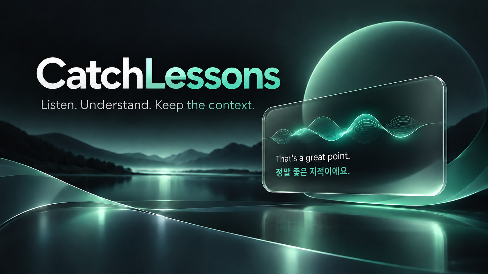
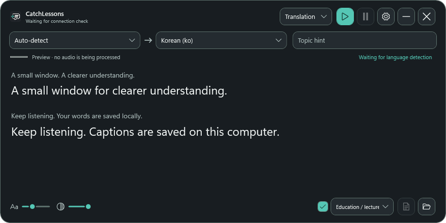

<p align="center"></p>

# CatchLessons

A personal desktop app that captures system audio, shows the source transcript and an optional translation in a floating window, and saves captions and notes locally.

I built CatchLessons to make studying more convenient. It is not a professional translation app.

[한국어 문서](README.ko.md)

> **Not instant real-time translation.** Source previews are provisional. Final captions are recognized in audio segments and translated through an agent request, so display can lag and earlier previews can change. Network, agent response, audio segmentation, and hardware all affect delay; no fixed latency is guaranteed.

<p align="center"></p>

## ✨ What it does

- **Translation or transcription:** view the original and translated captions, or capture only the original.
- **Floating captions:** drag and resize the window; controls hide when the pointer leaves. Adjust font size and opacity.
- **Pause recording:** the pause button stops accepting new audio; already captured speech and queued translation continue. Resume keeps the recording timeline continuous.
- **Notes:** choose a summary category and language, edit category prompts, and save a Markdown or plain-text summary. Run a summary on demand using the finalized transcript, or enable it when stopping.
- **Your agent:** use a signed-in Codex or Claude CLI conversation per recording. Choose a model, effort and optional translation instruction. Codex Fast mode is optional and can consume more of your allowance.
- **Local or API speech recognition:** local Whisper is the default. OpenAI API speech recognition is an alternative and requires an API key.
- **OpenAI API translation:** choose it separately in Connection settings. Speech recognition and translation reuse one securely stored API key. Translation streams through the Responses API (`gpt-6-luna`, reasoning disabled), with the topic, terminology, translation instruction and up to eight recent source/translation pairs (12,000 characters) as context.
- **OpenAI API summaries:** select **Settings → Summary → Summary provider → OpenAI API** independently of translation. It reuses the same key as speech recognition and translation. Manual, stop-time and retry summaries retain category prompts, output language, MD/TXT format and long-transcript reduction. Summaries use `gpt-6-luna` with low reasoning, up to 16,384 output tokens and a five-minute timeout per request. Incomplete results are rejected; existing notes and transcripts are preserved.
- **Background app:** close the window to hide it; restore or quit from the tray/menu bar.

When both providers are set to the selected agent, summaries and translations share the recording's agent conversation and run serially, so a long summary can delay later translations. API summaries run independently of translation and use finalized source text, not the unfinished preview or the translation context window. API-only translation or transcription with API summaries can start without a signed-in CLI. Post-recording Skill/MCP workflows always require the selected Codex/Claude agent, initialized when needed. Existing settings continue to use agent summaries until you select OpenAI API. API summary requests use `store: false` and send the recorded source and category instructions to OpenAI.

API speech recognition uses `gpt-live-transcribe` with low delay for both automatic and fixed source languages. Live source deltas are displayed before the audio turn is committed. Finalization uses natural utterances: Fast (0.8 seconds silence / 8 seconds maximum), Balanced (1.2 / 12), and More context (1.6 / 20), matching the existing Whisper presets. These limits finalize the source; they do not gate live draft display. The model does not return detected-language codes, so automatic API recognition no longer displays a detected language name. Local Whisper behavior is unchanged. In source version 1.3.0, API translation groups neighboring incomplete transcript chunks with up to 3.35 seconds of look-ahead before final translation. From source 1.4.0, Caption previews translate incoming source drafts while speech recognition is still running. A draft needs at least 20 characters; subsequent requests require a new turn, at least 12 added characters or a correction, and start at least two seconds apart. Only one request runs at a time and one newest source snapshot waits; superseded slow requests are canceled. Every request uses an isolated copy of confirmed context plus the topic, terminology and Custom Instruction. Final translations take priority and alone reach storage/exports. Extra preview requests are billed; cancellation does not refund tokens already processed. Turn Caption previews off to request only finalized translations. Tentative text can change as more speech arrives. For the lowest caption latency, select API speech recognition as well. Network, model latency and queued requests affect delay. Failed or interrupted translations retain the original and are marked incomplete; preview text is not exported as a final translation. Recent context is local to one recording and API requests use `store: false`.

After stopping, the captions remain visible and can be summarized again until a new recording starts. For Codex recordings, use the icon beside the session ID to open that same local conversation in the Codex app; the session ID can also be copied. Codex and CatchLessons must use the same local Codex history. Sessions created with `codex exec` may not appear automatically in the Codex sidebar. For Claude recordings, after stopping, use the Claude icon to open the same session in Claude Desktop. This requires Claude Code 2.1.285 or later, Claude Desktop, and a signed-in Claude subscription.

## 📦 Download and install

CatchLessons **1.4.0** adds translation previews that refresh while speech recognition is still running. Existing installations can use **Settings → Check for updates → Update**. Installer checksums are available in the [release assets](https://github.com/dlcks7456/catch-lessons/releases/tag/v1.4.0).

| Platform | Installer | Status |
| --- | --- | --- |
| Windows x64 | [Download .exe](https://github.com/dlcks7456/catch-lessons/releases/download/v1.4.0/CatchLessons-Windows-x64-1.4.0.exe) | Installation wizard; uninstall via Windows Settings |
| macOS 14+ · Apple Silicon | [Download .pkg](https://github.com/dlcks7456/catch-lessons/releases/download/v1.4.0/CatchLessons-macOS-arm64-1.4.0.pkg) | Experimental; real-device installation untested |
| macOS 14+ · Intel | [Download .pkg](https://github.com/dlcks7456/catch-lessons/releases/download/v1.4.0/CatchLessons-macOS-x64-1.4.0.pkg) | Experimental; real-device installation untested |

Open the downloaded installer and follow its instructions. Agent features require Codex CLI or Claude Code to be installed and signed in separately. On Windows, uninstall via **Settings → Apps → Installed apps → CatchLessons**; recordings and settings are retained.

During installation, **local Whisper is selected by default**. If no local model already exists, deselecting it makes the installation OpenAI-API-only; enter an API key in Connection settings. A valid existing Whisper model is reused when reinstalling, and the saved speech-engine setting is preserved. The installer bundles the .NET runtime and, when selected, the default Whisper and VAD models. The installer checks for agent executables and explains that sign-in is still required; it does not install or log in to an agent for you.

The Windows installer is currently **unsigned**, so Windows reputation checks may warn. The Mac build scripts produce unsigned/ad-hoc artifacts by default; public Mac distribution needs Developer ID signing and notarization. Mac installation, capture, Keychain, and shortcuts have not been verified on a Mac.

## 🚀 Start

1. For agent translation, agent summaries or workflows, install and sign in to [Codex CLI](https://developers.openai.com/codex/cli) or [Claude Code](https://code.claude.com/docs/en/setup).
2. Run the installer and choose whether to include local Whisper.
3. In **Settings → Connection**, choose the agent, translation provider and speech engine. Choose the summary provider in **Settings → Summary**. Selecting OpenAI API opens the shared-key dialog; key buttons beside Translation provider, Speech recognition engine and Summary provider reopen the same dialog. Connection checks use the draft key; only Save commits it. Custom Instruction and post-recording workflow are in the Instructions tab. Agent installation/sign-in is only needed for agent translation, agent summaries and workflows.
4. Choose source language (auto-detect or fixed), translation language, and an optional topic hint. Korean is the default translation language; the app interface defaults to English and can be switched to Korean.
5. Start recording. Pause/resume as needed. Stop to save captions and, if enabled, create a summary.

Windows uses system-output loopback, not the microphone. The macOS capture path is prepared but unverified. Translation and summaries require an internet connection even when Whisper is local. API speech sends audio to OpenAI; API translation sends source text, recent context and configured hints. API calls, including connection checks, incur API usage separately from Codex/Claude plan usage. Raw WAV recording is optional and off by default.

## ⌨️ Shortcuts

| Action | Default |
| --- | --- |
| Start / stop | `Ctrl + Alt + R` on Windows; `⌘ + Option + R` on Mac |
| Pause / resume | `Ctrl + Alt + P` on Windows; `⌘ + Option + P` on Mac |
| Settings | `Ctrl + Alt + S` on Windows; `⌘ + Option + S` on Mac |

Shortcuts are editable in Settings. Windows registers them globally when available; conflicts are shown in Settings and the conflicting key does not run. The current Mac implementation requires the app to have focus and has not been tested on macOS.

## 🗂️ Output

By default, each recording gets a new folder in `Documents/CatchLessons/`:

```text
<timestamp>_<id>/
├── srt/
│   ├── original.srt
│   └── translation.srt       # translation mode only
├── txt/
│   ├── original.txt
│   └── translation.txt       # translation mode only
├── <generated-title>.<language>.md  # or .txt; when summary enabled/run
└── audio.wav                 # only if original audio recording was enabled
```

A configured post-recording workflow can intentionally create other files. Existing recordings are not migrated or deleted. Settings and API-key storage retain the former CaptionGlass application-data location for compatibility. The app stores its recovery database and session metadata separately in its application-data directory; raw transcription and latency JSONL logs are no longer created. Summary files contain no YAML frontmatter or document links.

## 🔄 Updates

The build checks GitHub Releases at `dlcks7456/catch-lessons` from **Settings → General**. In a build with automatic updates, **Update** downloads and verifies the installer in the background, then installs it. Windows shows installation progress; macOS requests administrator authentication. Existing releases need a one-time manual upgrade to get this feature. Private GitHub Releases are not supported.

The app version and installer version come from `Directory.Build.props`. The repository can run `.github/workflows/build-installers.yml` manually to build artifacts; it does not publish a release automatically. The installer workflow has run on GitHub Actions; the Mac packages have not been tested on a physical Mac.

<details>
<summary>Developer build instructions</summary>

## 🛠️ Build

### Windows

Requires .NET 10 SDK, Inno Setup 6 and network access if the model files are not already available:

```powershell
./scripts/build.ps1
./scripts/build-windows-installer.ps1
```

The installer builder verifies model SHA-256 hashes and writes the standalone executable to `artifacts/installers/`. `./scripts/verify-windows-installer.ps1` tests both installer choices in unique workspace paths and uninstalls those test copies; it refuses to run if an existing CatchLessons installer registration is found.

### macOS — built, not tested on a physical Mac

On a Mac with .NET 10 SDK, Xcode Command Line Tools and macOS 14 or later:

```bash
bash installer/macos/build-pkg.sh
```

The script builds the app and an architecture-specific package, downloads and verifies models if necessary, and provides an optional local-model installation choice. It has run on GitHub-hosted macOS builders, but installation has not been tested. Optional `CAPTION_APP_SIGN_IDENTITY` and `CAPTION_INSTALLER_SIGN_IDENTITY` support local signing; notarization is a separate release step.

</details>

## 🔒 Data and limits

- Local Whisper processes audio on the device. The selected agent receives transcript text for translation, summary, or configured follow-up instructions.
- Optional WAV capture stores the source audio in the session folder. API speech recognition sends audio to OpenAI.
- Post-recording instructions may use configured tools and MCP under the agent's existing permission policy. Leave the instruction blank to disable the workflow.
- Speaker diarization and separate speaker audio are not implemented.
- User-created category names and instructions remain user data and are not automatically translated when the app UI language changes.

## 🧪 Verification and credits

The current review includes local regression tests, synthetic pause and queue tests, a public audio sample, and isolated Windows installer checks. See [VERIFICATION.md](VERIFICATION.md) for exact results and unverified paths. These checks do not prove live capture quality on every device.

CatchLessons uses Whisper.net, whisper.cpp, Silero VAD, NAudio, SQLite, Avalonia, Phosphor Icons and LobeHub brand assets. Notices are in [Assets/Licenses](Assets/Licenses) and [Assets/Icons](Assets/Icons). Hero and installer illustrations were generated for this project. No application license has been declared yet; review third-party licenses before distribution.


